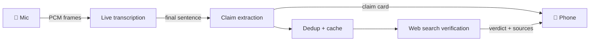

Language: EN | [PT-BR](README.pt-BR.md)

<p align="center">
  
</p>

# Veraz

**Real-time fact-checking for spoken conversations.** Point your phone at a debate, a podcast or a dinner-table argument. Veraz transcribes it live, spots the check-worthy claims and verifies each one against trusted sources, while people are still talking.

Built for Brazilian Portuguese first, with English support.

## How it works

The phone keeps one WebSocket open to the API. Audio goes up as binary PCM frames, and transcripts, claim cards and verdicts come back on the same socket.



The pipeline splits into two lanes so the slow part never blocks the fast part:

- **Hot lane:** audio → transcript → claim. The claim card reaches the phone as soon as extraction returns, before dedup or verification.
- **Cold lane:** verification runs in parallel behind a concurrency limit. It never slows down transcription.

## Features

- **Word-by-word transcription** while the speaker talks, not after they pause.
- **Claim extraction** that keeps only self-contained, check-worthy statements and ignores opinions and small talk.
- **Grounded verdicts:** every source URL must come from a real web search result. If none survive, the verdict drops to `UNVERIFIABLE`. The model cannot invent links.
- **Trusted sources by topic:** searches are limited to fact-checkers, news outlets and official data sites listed in [packages/shared/src/sources.ts](packages/shared/src/sources.ts).
- **12-verdict taxonomy** that goes beyond true/false (see below).
- **Contradiction detection:** flags a claim that contradicts something said earlier in the same session.
- **Verdict cache** in SQLite, matched by embedding similarity, so repeated claims resolve instantly.
- **Favorites and recheck:** save a claim and verify it again later, skipping the cache.
- **Latency metrics** per stage at `GET /metrics`.

### Verdicts

| Verdict | Meaning |
| --- | --- |
| True | Accurate and supported by reliable sources |
| True, but… | Literally accurate, but missing context changes how it reads |
| Not quite | Partly right; a detail (who, when, where, how) is wrong |
| Exaggerated | Right direction, inflated magnitude |
| Understated | Right direction, the real magnitude is larger |
| Distorted | Real data presented in a skewed way (cherry-picked period, wrong comparison) |
| Misleading | Each part may be true, but the whole leads to a false conclusion |
| False | Refuted by reliable sources or established facts |
| No evidence | Checkable, but no reliable source confirms or refutes it |
| Contradictory | Contradicts something said earlier in the conversation |
| Outdated | Was true once, newer data changed the picture |
| Unverifiable | Private, subjective or too vague to check |

Definitions live in [packages/shared/src/verdicts.ts](packages/shared/src/verdicts.ts) and are injected into the prompts.

## Tech stack

| Layer | Tech |
| --- | --- |
| Mobile | Expo (SDK 58), expo-router, `expo-audio`, zustand, FlashList |
| API | Node 24, Fastify 5, `@fastify/websocket`, TypeScript run directly (no build step) |
| AI | OpenAI Realtime transcription, Responses API with Structured Outputs and `web_search`, embeddings |
| Storage | SQLite (`node:sqlite`) for the verdict cache and favorites |
| Shared | zod schemas and WebSocket event types used by both apps |
| Tooling | pnpm workspaces, Biome |

```
apps/api/         Fastify API: pipeline, WebSocket, /metrics
apps/mobile/      Expo app: Live screen, claim detail, favorites
packages/shared/  zod schemas, verdict taxonomy, WS event types, PCM resampling
```

## Quick start

You need Node 24+, pnpm (`corepack enable`) and an OpenAI API key.

```bash
pnpm install
cp .env.example apps/api/.env        # then set OPENAI_API_KEY
pnpm dev:api                         # API on http://0.0.0.0:3000
```

Try the pipeline without a phone. `pnpm replay` runs a sample PT-BR transcript through the real models and prints the latency of each stage:

```bash
pnpm replay
```

Or send a sentence straight to a session:

```bash
ID=$(curl -s -XPOST localhost:3000/sessions | jq -r .id)
curl -XPOST "localhost:3000/sessions/$ID/text?wait=1" -H 'content-type: application/json' \
  -d '{"text":"A inflação em 2023 foi de 4,62 por cento."}'
curl -s localhost:3000/sessions/$ID | jq '.claims[0].result'
```

## Run on your iPhone

1. Connect the phone and the computer to the same Wi-Fi, and find the computer's LAN IP:
   - Linux: `hostname -I | awk '{print $1}'`
   - macOS: `ipconfig getifaddr en0`
   - Windows: `ipconfig` → IPv4 Address
2. Open `http://<ip>:3000/health` in Safari on the phone. If it doesn't load, open port 3000 in your firewall.
3. Create `apps/mobile/.env`:
   ```
   EXPO_PUBLIC_API_URL=http://<ip>:3000
   EXPO_PUBLIC_AUDIO_MODE=pcm-stream
   ```
4. Pick an audio mode below.

### `pcm-stream` (default, fastest): needs a development build

Streams raw PCM16 mic frames (~100 ms) over the WebSocket. The API resamples to 24 kHz if needed and feeds the Realtime transcription session.

```bash
cd apps/mobile
pnpm exec expo run:ios --device   # needs Xcode + an Apple developer account (free is OK)
pnpm start:dev-client             # later runs: start Metro and open the installed app
```

No Mac? Build with EAS instead (EAS account required), then install on the device:

```bash
pnpm dlx eas-cli build --profile development --platform ios
```

### `chunked`: works in Expo Go

Records 5 s `m4a` chunks back to back and sends each one as a binary message. It is slower, because a chunk is only transcribed after it ends, and sentences can be cut at chunk borders.

```bash
cd apps/mobile
EXPO_PUBLIC_AUDIO_MODE=chunked pnpm exec expo start   # scan the QR code with Expo Go
```

> [!TIP]
> The text box on the Live screen works in both modes. It is the fastest way to test the pipeline without speaking.

## Configuration

The API reads `apps/api/.env`. The mobile app reads `apps/mobile/.env` (the `EXPO_PUBLIC_*` vars). [.env.example](.env.example) lists both. Models, sources and prompts are plain files: [apps/api/src/config.ts](apps/api/src/config.ts), [packages/shared/src/sources.ts](packages/shared/src/sources.ts) and [apps/api/prompts/](apps/api/prompts/).

<details>
<summary><strong>Environment variables</strong></summary>

| Var | Where | Default | Meaning |
| --- | --- | --- | --- |
| `OPENAI_API_KEY` | api | – | Required |
| `PORT` | api | `3000` | Listens on `0.0.0.0` |
| `MODEL_TRANSCRIBE` | api | `gpt-live-transcribe` | Realtime transcription. Streams text while you speak; `gpt-transcribe` waits for a pause (server VAD) |
| `MODEL_TRANSCRIBE_CHUNK` | api | `gpt-4o-mini-transcribe` | `chunked` mode |
| `MODEL_EXTRACT` / `MODEL_VERIFY` | api | `gpt-5.6-luna` | Claim extraction / verification |
| `MODEL_EMBED` | api | `text-embedding-3-small` | Dedup and cache |
| `EXTRACT_EFFORT` / `VERIFY_EFFORT` | api | `none` / `low` | Reasoning effort |
| `VERIFY_CONCURRENCY` / `VERIFY_TIMEOUT_MS` | api | `4` / `45000` | Parallel verifications, per-call timeout |
| `VAD_SILENCE_MS` | api | `400` | Silence that ends an utterance. Lower = faster, more cut sentences |
| `VAD_SPEECH_DB` / `VAD_MAX_TURN_MS` | api | `-45` / `12000` | `gpt-live-transcribe` turn detection: speech level in dBFS (raise it in noisy rooms), longest utterance before a forced cut |
| `DEDUP_THRESHOLD` / `CACHE_THRESHOLD` / `CACHE_TTL_HOURS` | api | `0.9` / `0.92` / `24` | Cosine thresholds, cache TTL |
| `DB_PATH` | api | `veraz.db` | SQLite verdict cache |
| `EXPO_PUBLIC_API_URL` | mobile | – | `http://<your LAN IP>:3000` |
| `EXPO_PUBLIC_AUDIO_MODE` | mobile | `pcm-stream` | `pcm-stream` or `chunked` |

</details>

## API reference

<details>
<summary><strong>Routes</strong></summary>

| Route | |
| --- | --- |
| `POST /sessions` | Body `{mode?: "pcm-stream"\|"chunked", sampleRate?}` → `{id}`. Opens the upstream Realtime connection right away so it is warm |
| `GET /sessions/:id` | Session state (claims, utterances) |
| `DELETE /sessions/:id` | End session |
| `GET /sessions/:id/ws` | Binary audio in; JSON events out (`snapshot`, `partial`, `utterance`, `claim`, `claim.removed`, `error`). Reconnecting returns a fresh `snapshot` |
| `DELETE /sessions/:id/claims/:claimId` | Remove a claim; cancels its check if still running (idempotent, 204). The session emits `claim.removed` |
| `POST /sessions/:id/claims/:claimId/recheck` | Check a settled claim again, skipping the cache (202). The claim goes back to `checking` and its new verdict arrives on the socket; 400 if it is still being checked |
| `POST /sessions/:id/text` | `{text}` injects an utterance (`?wait=1` waits until its claims settle) |
| `GET /favorites` | Saved claims, newest first |
| `POST /favorites` | `{sessionId, claimId}` copies a verified claim from its session → the favorite (idempotent) |
| `POST /favorites/:id/recheck` | Check a favorite again, skipping the cache, and keep the new verdict → the updated favorite. With `{sessionId}`, a claim still in that live session is rechecked there, so its card updates too |
| `DELETE /favorites/:id` | Remove a favorite (idempotent, always 204) |
| `GET /metrics` | Latency and token usage |
| `GET /health` | |

</details>

<details>
<summary><strong>Reading <code>/metrics</code></strong></summary>

```json
{
  "latencyMs": {
    "transcribe": { "n": 12, "p50": 310, "p95": 540 },
    "extract":    { "n": 12, "p50": 420, "p95": 800 },
    "verify":     { "n": 9,  "p50": 6200, "p95": 14000 },
    "total":      { "n": 9,  "p50": 7000, "p95": 15000 }
  },
  "eventLoopDelayMs": { "p50": 0, "p99": 1.2, "max": 4.8 },
  "tokens": { "extract": { "input": 0, "cached": 0, "output": 0, "reasoning": 0, "calls": 0 }, "verify": {}, "embed": {} },
  "claims": { "detected": 0, "verified": 0, "errors": 0, "cacheHits": 0, "duplicates": 0 }
}
```

- `transcribe`: end of speech → final transcript.
- `extract`: final transcript → claim detected (the card appears on the phone at this point).
- `verify`: claim detected → verdict.
- `total`: end of speech → verdict.
- `eventLoopDelayMs`: how long the event loop was blocked. Anything above a few ms slows every lane; move CPU work to a worker thread.
- `tokens.*.cached`: how much input hit OpenAI prompt caching. Prompts keep a byte-identical static prefix and put variable content last.

</details>

## Design notes

- **Modular API.** Three modules live under [apps/api/src/modules/](apps/api/src/modules/): `transcription` turns audio into utterances, `factcheck` owns sessions, claims and verdicts, and `favorites` keeps the claims the user saved. Every external service (OpenAI, SQLite) sits behind a port, and [container.ts](apps/api/src/container.ts) is the only place that wires the adapters. [CLAUDE.md](CLAUDE.md) has the conventions; [architecture.md](architecture.md) has the target design.
- **Cards before verification.** A duplicate card is removed afterwards with a `claim.removed` event, so the phone never waits on dedup.
- **Cancellation.** Ending a session aborts its in-flight model calls through one `AbortSignal`.
- **Cache.** Verdicts persist in SQLite and match by embedding similarity (TTL 24 h). `CONTRADICTORY` depends on the session, so it is never cached.

## Development

```bash
pnpm dev:api       # API with --watch
pnpm dev:mobile    # Expo
pnpm typecheck     # tsc in every package
pnpm check         # Biome format + lint, writes fixes (pnpm lint only reports)
```

There are no mocks: everything runs against the real OpenAI API. Run `pnpm check && pnpm typecheck` before committing.

## Roadmap

- [ ] Translate the app to English
- [ ] Support multiple speakers (identify who said each claim)

## Known limitations

- Verification takes seconds because it runs a web search, so cards stay in "verificando…" for a while. Raise `VERIFY_EFFORT` for quality; keep it at `low` for speed.
- If `gpt-live-transcribe` or `gpt-5.6-luna` isn't available to your account, override the `MODEL_*` vars.
- Sessions live in memory: a server restart drops them, and the app starts a new one. Sessions are only freed by `DELETE`.
- `CONTRADICTORY` only considers verified claims from the same session, and a cache hit skips that check.
- Dedup uses embedding similarity, so paraphrases with different numbers may still merge if they score above the threshold.
- Local prototype: no auth, HTTP only, LAN only.
