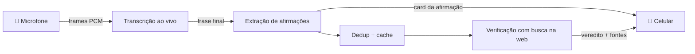

Idioma: [EN](README.md) | PT-BR

<p align="center">
  
</p>

# Veraz

**Checagem de fatos em tempo real para conversas faladas.** Aponte o celular para um debate, um podcast ou uma discussão no jantar. O Veraz transcreve ao vivo, identifica as afirmações que valem ser checadas e verifica cada uma em fontes confiáveis, enquanto as pessoas ainda estão falando.

Feito primeiro para o português do Brasil, com suporte a inglês.

## Como funciona

O celular mantém um único WebSocket aberto com a API. O áudio sobe como frames PCM binários, e as transcrições, os cards de afirmação e os vereditos voltam pelo mesmo socket.



O pipeline se divide em duas pistas, para que a parte lenta nunca trave a parte rápida:

- **Pista quente:** áudio → transcrição → afirmação. O card chega ao celular assim que a extração retorna, antes do dedup e da verificação.
- **Pista fria:** a verificação roda em paralelo, com limite de concorrência. Ela nunca atrasa a transcrição.

## Funcionalidades

- **Transcrição palavra por palavra** enquanto a pessoa fala, e não só depois que ela pausa.
- **Extração de afirmações** que mantém só declarações autocontidas e checáveis, ignorando opiniões e conversa fiada.
- **Vereditos fundamentados:** toda URL de fonte precisa vir de um resultado real da busca na web. Se nenhuma sobrar, o veredito cai para `UNVERIFIABLE`. O modelo não consegue inventar links.
- **Fontes confiáveis por tema:** as buscas ficam restritas a agências de checagem, veículos de imprensa e sites de dados oficiais listados em [packages/shared/src/sources.ts](packages/shared/src/sources.ts).
- **Taxonomia de 12 vereditos** que vai além de verdadeiro/falso (veja abaixo).
- **Detecção de contradições:** sinaliza uma afirmação que contradiz algo dito antes na mesma sessão.
- **Cache de vereditos** em SQLite, com busca por similaridade de embeddings, para que afirmações repetidas se resolvam na hora.
- **Favoritos e rechecagem:** salve uma afirmação e verifique de novo depois, ignorando o cache.
- **Métricas de latência** por etapa em `GET /metrics`.

### Vereditos

| Veredito | Significado |
| --- | --- |
| Verdadeiro | Correto e sustentado por fontes confiáveis |
| Verdadeiro, mas… | Correto ao pé da letra, mas falta um contexto que muda a leitura |
| Não é bem assim | Em parte certo; um detalhe (quem, quando, onde, como) está errado |
| Exagerado | Direção certa, tamanho inflado |
| Subestimado | Direção certa, o tamanho real é maior |
| Distorcido | Dados reais apresentados de forma torta (período escolhido a dedo, comparação errada) |
| Enganoso | Cada parte pode estar certa, mas o conjunto leva a uma conclusão falsa |
| Falso | Desmentido por fontes confiáveis ou por fatos estabelecidos |
| Sem provas | Dá para checar, mas nenhuma fonte confiável confirma nem desmente |
| Contraditório | Contradiz algo dito antes na conversa |
| Desatualizado | Já foi verdade, mas dados mais recentes mudaram o quadro |
| Não verificável | Privado, subjetivo ou vago demais para checar |

As definições ficam em [packages/shared/src/verdicts.ts](packages/shared/src/verdicts.ts) e são injetadas nos prompts.

## Stack

| Camada | Tecnologia |
| --- | --- |
| Mobile | Expo (SDK 58), expo-router, `expo-audio`, zustand, FlashList |
| API | Node 24, Fastify 5, `@fastify/websocket`, TypeScript executado direto (sem build) |
| IA | Transcrição OpenAI Realtime, Responses API com Structured Outputs e `web_search`, embeddings |
| Armazenamento | SQLite (`node:sqlite`) para o cache de vereditos e os favoritos |
| Compartilhado | Schemas zod e tipos de eventos WebSocket usados pelos dois apps |
| Ferramentas | pnpm workspaces, Biome |

```
apps/api/         API Fastify: pipeline, WebSocket, /metrics
apps/mobile/      App Expo: tela Ao Vivo, detalhe da afirmação, favoritos
packages/shared/  schemas zod, taxonomia de vereditos, tipos de eventos WS, reamostragem PCM
```

## Início rápido

Você precisa de Node 24+, pnpm (`corepack enable`) e uma chave da API da OpenAI.

```bash
pnpm install
cp .env.example apps/api/.env        # depois defina OPENAI_API_KEY
pnpm dev:api                         # API em http://0.0.0.0:3000
```

Teste o pipeline sem celular. O `pnpm replay` roda uma transcrição de exemplo em PT-BR pelos modelos reais e mostra a latência de cada etapa:

```bash
pnpm replay
```

Ou envie uma frase direto para uma sessão:

```bash
ID=$(curl -s -XPOST localhost:3000/sessions | jq -r .id)
curl -XPOST "localhost:3000/sessions/$ID/text?wait=1" -H 'content-type: application/json' \
  -d '{"text":"A inflação em 2023 foi de 4,62 por cento."}'
curl -s localhost:3000/sessions/$ID | jq '.claims[0].result'
```

## Rodar no iPhone

1. Conecte o celular e o computador ao mesmo Wi-Fi e descubra o IP do computador na rede local:
   - Linux: `hostname -I | awk '{print $1}'`
   - macOS: `ipconfig getifaddr en0`
   - Windows: `ipconfig` → Endereço IPv4
2. Abra `http://<ip>:3000/health` no Safari do celular. Se não carregar, libere a porta 3000 no firewall.
3. Crie `apps/mobile/.env`:
   ```
   EXPO_PUBLIC_API_URL=http://<ip>:3000
   EXPO_PUBLIC_AUDIO_MODE=pcm-stream
   ```
4. Escolha um modo de áudio abaixo.

### `pcm-stream` (padrão, mais rápido): precisa de um development build

Envia frames PCM16 crus do microfone (~100 ms) pelo WebSocket. A API reamostra para 24 kHz se precisar e alimenta a sessão de transcrição Realtime.

```bash
cd apps/mobile
pnpm exec expo run:ios --device   # precisa de Xcode + conta de desenvolvedor Apple (a gratuita serve)
pnpm start:dev-client             # nas próximas vezes: inicie o Metro e abra o app instalado
```

Sem Mac? Gere o build pelo EAS (precisa de conta EAS) e instale no aparelho:

```bash
pnpm dlx eas-cli build --profile development --platform ios
```

### `chunked`: funciona no Expo Go

Grava trechos `m4a` de 5 s em sequência e envia cada um como mensagem binária. É mais lento, porque um trecho só é transcrito depois que termina, e as frases podem ser cortadas na borda dos trechos.

```bash
cd apps/mobile
EXPO_PUBLIC_AUDIO_MODE=chunked pnpm exec expo start   # leia o QR code com o Expo Go
```

> [!TIP]
> A caixa de texto da tela Ao Vivo funciona nos dois modos. É o jeito mais rápido de testar o pipeline sem falar.

## Configuração

A API lê `apps/api/.env`. O app mobile lê `apps/mobile/.env` (as variáveis `EXPO_PUBLIC_*`). O [.env.example](.env.example) lista as duas. Modelos, fontes e prompts são arquivos simples: [apps/api/src/config.ts](apps/api/src/config.ts), [packages/shared/src/sources.ts](packages/shared/src/sources.ts) e [apps/api/prompts/](apps/api/prompts/).

<details>
<summary><strong>Variáveis de ambiente</strong></summary>

| Variável | Onde | Padrão | Significado |
| --- | --- | --- | --- |
| `OPENAI_API_KEY` | api | – | Obrigatória |
| `PORT` | api | `3000` | Escuta em `0.0.0.0` |
| `MODEL_TRANSCRIBE` | api | `gpt-live-transcribe` | Transcrição Realtime. Transmite o texto enquanto você fala; `gpt-transcribe` espera uma pausa (VAD do servidor) |
| `MODEL_TRANSCRIBE_CHUNK` | api | `gpt-4o-mini-transcribe` | Modo `chunked` |
| `MODEL_EXTRACT` / `MODEL_VERIFY` | api | `gpt-5.6-luna` | Extração / verificação de afirmações |
| `MODEL_EMBED` | api | `text-embedding-3-small` | Dedup e cache |
| `EXTRACT_EFFORT` / `VERIFY_EFFORT` | api | `none` / `low` | Esforço de raciocínio |
| `VERIFY_CONCURRENCY` / `VERIFY_TIMEOUT_MS` | api | `4` / `45000` | Verificações em paralelo, timeout por chamada |
| `VAD_SILENCE_MS` | api | `400` | Silêncio que encerra uma fala. Menor = mais rápido, mais frases cortadas |
| `VAD_SPEECH_DB` / `VAD_MAX_TURN_MS` | api | `-45` / `12000` | Detecção de turno do `gpt-live-transcribe`: nível de fala em dBFS (aumente em ambientes barulhentos), fala mais longa antes de um corte forçado |
| `DEDUP_THRESHOLD` / `CACHE_THRESHOLD` / `CACHE_TTL_HOURS` | api | `0.9` / `0.92` / `24` | Limiares de cosseno, TTL do cache |
| `DB_PATH` | api | `veraz.db` | Cache de vereditos em SQLite |
| `EXPO_PUBLIC_API_URL` | mobile | – | `http://<IP na sua rede local>:3000` |
| `EXPO_PUBLIC_AUDIO_MODE` | mobile | `pcm-stream` | `pcm-stream` ou `chunked` |

</details>

## Referência da API

<details>
<summary><strong>Rotas</strong></summary>

| Rota | |
| --- | --- |
| `POST /sessions` | Corpo `{mode?: "pcm-stream"\|"chunked", sampleRate?}` → `{id}`. Abre a conexão Realtime upstream na hora, para ela já estar aquecida |
| `GET /sessions/:id` | Estado da sessão (afirmações, falas) |
| `DELETE /sessions/:id` | Encerra a sessão |
| `GET /sessions/:id/ws` | Áudio binário na entrada; eventos JSON na saída (`snapshot`, `partial`, `utterance`, `claim`, `claim.removed`, `error`). Reconectar devolve um `snapshot` novo |
| `DELETE /sessions/:id/claims/:claimId` | Remove uma afirmação; cancela a checagem se ainda estiver rodando (idempotente, 204). A sessão emite `claim.removed` |
| `POST /sessions/:id/claims/:claimId/recheck` | Checa de novo uma afirmação já resolvida, ignorando o cache (202). A afirmação volta para `checking` e o novo veredito chega pelo socket; 400 se ainda estiver sendo checada |
| `POST /sessions/:id/text` | `{text}` injeta uma fala (`?wait=1` espera até as afirmações dela se resolverem) |
| `GET /favorites` | Afirmações salvas, das mais novas para as mais antigas |
| `POST /favorites` | `{sessionId, claimId}` copia uma afirmação verificada da sessão → o favorito (idempotente) |
| `POST /favorites/:id/recheck` | Checa um favorito de novo, ignorando o cache, e guarda o novo veredito → o favorito atualizado. Com `{sessionId}`, uma afirmação que ainda está naquela sessão ao vivo é rechecada lá, então o card também é atualizado |
| `DELETE /favorites/:id` | Remove um favorito (idempotente, sempre 204) |
| `GET /metrics` | Latência e uso de tokens |
| `GET /health` | |

</details>

<details>
<summary><strong>Lendo o <code>/metrics</code></strong></summary>

```json
{
  "latencyMs": {
    "transcribe": { "n": 12, "p50": 310, "p95": 540 },
    "extract":    { "n": 12, "p50": 420, "p95": 800 },
    "verify":     { "n": 9,  "p50": 6200, "p95": 14000 },
    "total":      { "n": 9,  "p50": 7000, "p95": 15000 }
  },
  "eventLoopDelayMs": { "p50": 0, "p99": 1.2, "max": 4.8 },
  "tokens": { "extract": { "input": 0, "cached": 0, "output": 0, "reasoning": 0, "calls": 0 }, "verify": {}, "embed": {} },
  "claims": { "detected": 0, "verified": 0, "errors": 0, "cacheHits": 0, "duplicates": 0 }
}
```

- `transcribe`: fim da fala → transcrição final.
- `extract`: transcrição final → afirmação detectada (é aqui que o card aparece no celular).
- `verify`: afirmação detectada → veredito.
- `total`: fim da fala → veredito.
- `eventLoopDelayMs`: quanto tempo o event loop ficou bloqueado. Qualquer coisa acima de alguns ms atrasa todas as pistas; mova trabalho de CPU para uma worker thread.
- `tokens.*.cached`: quanto do input aproveitou o prompt caching da OpenAI. Os prompts mantêm um prefixo estático idêntico byte a byte e deixam o conteúdo variável no final.

</details>

## Notas de design

- **API modular.** Três módulos ficam em [apps/api/src/modules/](apps/api/src/modules/): `transcription` transforma áudio em falas, `factcheck` cuida de sessões, afirmações e vereditos, e `favorites` guarda as afirmações que o usuário salvou. Todo serviço externo (OpenAI, SQLite) fica atrás de uma porta, e o [container.ts](apps/api/src/container.ts) é o único lugar que conecta os adapters. O [CLAUDE.md](CLAUDE.md) tem as convenções; o [architecture.md](architecture.md) tem o design-alvo.
- **Cards antes da verificação.** Um card duplicado é removido depois com um evento `claim.removed`, então o celular nunca espera o dedup.
- **Cancelamento.** Encerrar uma sessão aborta as chamadas aos modelos em andamento por meio de um único `AbortSignal`.
- **Cache.** Os vereditos ficam salvos em SQLite e são encontrados por similaridade de embeddings (TTL de 24 h). `CONTRADICTORY` depende da sessão, então nunca vai para o cache.

## Desenvolvimento

```bash
pnpm dev:api       # API com --watch
pnpm dev:mobile    # Expo
pnpm typecheck     # tsc em todos os pacotes
pnpm check         # Biome format + lint, aplica correções (pnpm lint só reporta)
```

Não há mocks: tudo roda contra a API real da OpenAI. Rode `pnpm check && pnpm typecheck` antes de commitar.

## Roadmap

- [ ] Traduzir o app para inglês
- [ ] Suportar vários falantes (identificar quem disse cada afirmação)

## Limitações conhecidas

- A verificação leva alguns segundos porque faz uma busca na web, então os cards ficam em "verificando…" por um tempo. Aumente o `VERIFY_EFFORT` para mais qualidade; mantenha em `low` para mais velocidade.
- Se `gpt-live-transcribe` ou `gpt-5.6-luna` não estiverem disponíveis na sua conta, sobrescreva as variáveis `MODEL_*`.
- As sessões ficam em memória: reiniciar o servidor apaga todas, e o app inicia uma nova. Uma sessão só é liberada com `DELETE`.
- `CONTRADICTORY` só considera afirmações verificadas da mesma sessão, e um acerto no cache pula essa checagem.
- O dedup usa similaridade de embeddings, então paráfrases com números diferentes ainda podem ser fundidas se passarem do limiar.
- Protótipo local: sem autenticação, só HTTP, só na rede local.
